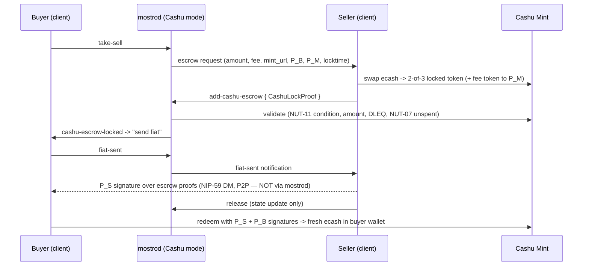
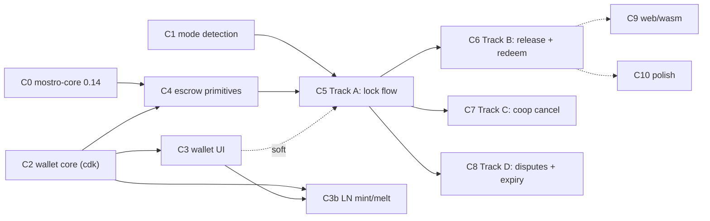

# Cashu Escrow — Client Implementation Spec & Phased Plan

**Status:** In progress — C0, C1a, C1b, C2, C3 and C4 merged (`mostro-core` 0.14 + wire form pinned; escrow-mode detection and overrides; embedded wallet over cdk and its UI; 2-of-3 escrow primitives); C5 (seller escrow lock) in review (#238)
**Goal:** ship Cashu as a user-selectable settlement backend alongside Lightning — see §1.1
**Audience:** contributors implementing Cashu support in this client (appv2)
**Upstream reference:** [`MostroP2P/mostro` — Cashu escrow spec series](https://github.com/MostroP2P/mostro/tree/main/docs/cashu)

---

## 1. Goal

Add support for **Cashu escrow mode** to this client so that trades can be completed
against a `mostrod` node that runs in Cashu mode instead of Lightning mode, as specified
in the daemon-side spec series:

- [`docs/CASHU_ESCROW_ARCHITECTURE.md`](https://github.com/MostroP2P/mostro/blob/main/docs/CASHU_ESCROW_ARCHITECTURE.md) — architecture, trust model, 2-of-3 mechanism
- [`docs/cashu/README.md`](https://github.com/MostroP2P/mostro/blob/main/docs/cashu/README.md) — daemon roadmap (Foundation + Tracks A–D)
- [`docs/cashu/01-fundamentals.md`](https://github.com/MostroP2P/mostro/blob/main/docs/cashu/01-fundamentals.md) — config, `CashuClient`, DB, boot (CF-0…CF-5)
- [`docs/cashu/02-track-a-lock.md`](https://github.com/MostroP2P/mostro/blob/main/docs/cashu/02-track-a-lock.md) — escrow lock via `AddCashuEscrow`
- Tracks B (release), C (cooperative cancel), D (disputes) — planned upstream; this plan
  anticipates them from the architecture doc and must be re-checked when they are published.

### 1.1 What this is for — read this before planning anything

**The goal is a shipped product feature: Cashu escrow available to real users, in
`mostrod` and in this client, so that a user can choose whether to trade on a Mostro node
that settles over Cashu or one that settles over Lightning.** Both backends are
first-class and both are permanent. Cashu is not an experiment, and Lightning is not being
replaced.

Testing the daemon end-to-end is the **first milestone on the way there**, not the
destination. It is genuinely useful — as each daemon track lands, the client should have
the matching capability ready — but it is a checkpoint, and treating it as the finish line
produces the wrong calls at exactly the points where they are expensive to undo.

Concretely, the difference changes these decisions:

| If the goal were "test the daemon" | Because the goal is "users choose their node" |
|---|---|
| The embedded wallet only has to survive a test run | It holds **user funds**. Ecash is bearer: a lost wallet DB is lost money. Backup/restore is a **release requirement**, not Wave-4 polish |
| Errors can surface as raw markers to a developer | Every failure a user can reach needs a localized, actionable message and a way out |
| Web can say "Cashu not available" indefinitely | Web is a first-class target of this app. A Cashu node being unusable there means the user's node choice silently depends on their platform |
| The dev override is the way in | Users never see the override. **Detection must work off the node's own advertisement**, which makes the upstream 38385 tags (§4.1) a release blocker, not a convenience |
| One tester who already knows the trust model | The mint is a **new trust assumption** users did not have in Lightning mode. They must see which mint a node uses *before* trading, not after |
| Ship when the flows work | Ship when the flows work **and** funds are recoverable on every failure path — including "Mostro vanished" (locktime refund) and "user reinstalled the app" |

None of this changes the phase order in §6 — the dependency graph is unaffected. It changes
**which phases are optional**, which is why Wave 4 is no longer called "optional
hardening".

### 1.2 The app always has Lightning, NWC and Cashu

**Lightning, NWC and the Cashu wallet are always active in the app.** This rule
overrides any other line of this document:

- **Lightning** keeps working as it always has: invoices, the default Lightning
  address and the hold-invoice flow on Lightning nodes.
- **NWC** stays reachable from Settings, whatever node is active.
- **The Cashu wallet** stays reachable from Settings, whatever node is active,
  including on a Lightning node or a node that does not advertise `escrow_mode`.

The active node's escrow mode (§4) decides one thing only: **how a trade on that node
settles**, with a hold invoice or a Cashu escrow. It never hides, disables or removes a
payment method, and switching nodes never changes which of the three the user can open.
Whether the wallet's mint can lock a given order is checked when locking, not by
hiding the wallet (§4.1).

### Non-goals

- No general-purpose Cashu wallet product. The embedded wallet exists to fund/redeem
  escrows; anything beyond that is out of scope. It is always reachable (§1.2).
  This bounds the wallet's **feature set**, not its quality bar — within that scope it
  handles real money and is held to it.
- No escrow mint of the client's own choosing beyond what the node accepts (the wallet's
  own mint is the user's choice, C2; an escrow is locked only on the order's mint). Since
  [MostroP2P/mostro#1047](https://github.com/MostroP2P/mostro/pull/1047) the **maker**
  picks each order's mint, among the node's `[cashu] mint_urls` (or any public mint when
  the list is empty), and the taker accepts it by taking. This client reads the list and
  each order's mint; picking one when creating an order, and a wallet that follows the
  order's mint, are still to come (see §4.1).
- No change of any kind to the Lightning flows. Cashu **trade flows** run only on a node
  in Cashu mode; the Cashu wallet itself is always available (§1.2). Lightning stays fully
  supported: this is a choice offered to users, never a migration imposed on them.

---

## 2. Background — how Cashu escrow works (daemon spec summary)

In Cashu mode, `mostrod` never holds funds. Escrow is a Cashu token locked with a
**NUT-11 P2PK 2-of-3 spending condition** over three keys:

| Key | Who | Notes |
|-----|-----|-------|
| `P_B` | Buyer | **Per-order trade key** (never the identity key) |
| `P_S` | Seller | **Per-order trade key** |
| `P_M` | Mostro | Arbitrator key, used only in disputes |

Any 2 of the 3 signatures spend the token. A NUT-11 `locktime` (daemon default 15 days)
with `refund = [P_S]` lets the seller reclaim unilaterally after expiry, so funds can
never be permanently stuck.

Happy path (sell order, from the architecture doc):



Key client-relevant deltas vs Lightning mode:

| Lightning mode | Cashu mode |
|---|---|
| Seller pays a **hold invoice** (`pay-invoice` action carries bolt11) | Seller **locks a 2-of-3 token at the mint** and submits it with `add-cashu-escrow` |
| Buyer submits a **bolt11 / LN address** (`add-invoice`) | **No buyer invoice step at all** — buyer redeems the token directly at the end |
| Settlement happens daemon-side (settle hold invoice, pay buyer) | Settlement is **client-side**: seller's signature travels **P2P buyer↔seller over NIP-59**, buyer countersigns and swaps at the mint |
| Mostro fee skimmed from the payout | Seller funds a **separate fee token** (`2 * order.fee`, P2PK 1-of-1 to `P_M`) at lock time |
| Cancel/dispute resolved by daemon via LND | Cancel: buyer sends their signature P2P to seller. Dispute: winner receives `P_M` signature via `cashu-pm-signature` and redeems |

### Protocol surface (frozen in `mostro-core`)

Already published in `mostro-core` (Actions/Payloads since 0.13.x/0.14.0; this client is
on **0.13.1** and must upgrade to **≥ 0.14.0** for `CashuLockProof.fee_token`):

- **Actions:** `AddCashuEscrow` (seller → mostro), `CashuEscrowLocked` (mostro → parties),
  `CashuPmSignature` (mostro → dispute winner)
- **Payloads:**
  - `Payload::CashuLockProof { token, mint_url, buyer_pubkey, seller_pubkey, mostro_pubkey, fee_token: Option<String> }`
    (all pubkeys x-only hex; `fee_token` added in 0.14.0, `#[serde(default)]`)
  - `Payload::CashuSignatures(Vec<CashuProofSignature>)` with `{ secret, signature }` per proof
- **`CantDoReason`s:** `InvalidCashuToken`, `CashuMintUnavailable`, `InvalidMintUrl`,
  `CashuEscrowNotLocked`, `CashuSignatureMissing`

Wire message (rumor content of the NIP-44/Kind-14 transport). **Confirmed against
`mostro-core` 0.14.1 in Phase C0** and pinned by tests in
`rust/src/mostro/cashu_wire.rs`, so an upstream rename fails our suite instead of a live
trade: `Action` is `rename_all = "kebab-case"`, `Payload` is `rename_all = "snake_case"`
(hence the `cashu_lock_proof` discriminator), `CashuLockProof`'s field names are exactly
as written below, and `fee_token` is `skip_serializing_if = "Option::is_none"` — a node
charging no fee produces the pre-0.14 form byte-for-byte. The example below is accurate:

```json
{
  "order": {
    "version": 2,
    "id": "ede61c96-4c13-4519-bf3a-dcf7f1e9d842",
    "request_id": 981234,
    "trade_index": 7,
    "action": "add-cashu-escrow",
    "payload": {
      "cashu_lock_proof": {
        "token": "cashuBo2Ftd2h0dHBzOi8vbWludC5leGFtcGxlLmNvbaF0...",
        "mint_url": "https://mint.example.com",
        "buyer_pubkey": "9f3a...c1",
        "seller_pubkey": "77b2...9e",
        "mostro_pubkey": "dbe0...42",
        "fee_token": "cashuBo2Ftd2h0dHBzOi8vbWludC5leGFtcGxlLmNvbaF0..."
      }
    }
  }
}
```

And the NUT-11 secret the seller's wallet must construct for each escrow proof
(construction per Track A; `data = P_S`, refund path seller-only):

```json
["P2PK", {
  "nonce": "<random>",
  "data": "<P_S compressed hex>",
  "tags": [
    ["pubkeys", "<P_B compressed hex>", "<P_M compressed hex>"],
    ["n_sigs", "2"],
    ["sigflag", "SIG_INPUTS"],
    ["locktime", "<unix: now + escrow_locktime_days>"],
    ["refund", "<P_S compressed hex>"],
    ["n_sigs_refund", "1"]
  ]
}]
```

> **Key encoding note.** Nostr trade keys are x-only (32 bytes); Cashu P2PK uses
> compressed SEC1 keys (33 bytes). The daemon maps with
> `cashu_pubkey_from_xonly_hex` (prefix `02`). The client must apply the identical
> mapping and must use the **per-order trade key** derived at
> `rust/src/api/identity.rs` (`derive_trade_key`), never the identity key —
> this is a hard privacy requirement of the upstream spec.

---

## 3. Client design principles

1. **Trade flows follow the node; payment methods are always there.** Cashu **trade
   flows** (escrow lock, release, cancel, dispute) are gated behind the active node's
   escrow mode: against a Lightning node (or an old daemon that predates the info tags)
   every trade runs the Lightning flow, byte-for-byte as today. The payment methods are
   not gated: Lightning, NWC and the Cashu wallet are always available in Settings
   (§1.2).
2. **No crypto in Dart** (repo golden rule). All Cashu operations — mint HTTP calls,
   token construction, NUT-11 conditions, signatures, redemption — live in Rust
   (`rust/src/cashu/`), built on the [`cdk`](https://github.com/cashubtc/cdk) crate.
   Dart gets only FRB view-models and commands.
3. **Additive persistence.** `TradeInfo` is stored as a JSON blob
   (`rust/src/api/types.rs`), so new `Option<...>` fields are migration-light. The cdk
   wallet gets its own storage; it never touches existing tables.
4. **Small, stacked-or-parallel PRs** (one phase = one PR), matching the repo workflow
   and the daemon's CF-0…CF-5 / Track A–D structure so client phases can be tested
   against the corresponding daemon track as it lands.
5. **Copy proven in-repo patterns**, not invent new ones:
   - Capability detection: the anti-abuse-bond tri-state parsed from Kind 38385 tags
     (`BondPolicy { unsupported, disabled, enabled }` in
     `lib/features/about/models/mostro_instance.dart`) and the `fetch_and_set_pow`
     fetch hook (`rust/src/api/nostr.rs`).
   - Native/WASM split: the NWC client's `#[cfg(target_arch = "wasm32")]` stub
     (`rust/src/nwc/client.rs`).
   - Request correlation: `PendingRequestKind` in `rust/src/api/orders.rs`.

---

## 4. Mode detection — which flow a trade on the node uses

The client already fetches the daemon's **Kind 38385 instance-info event** (tag
`z = "info"`) via `fetch_mostro_instance_tags` (`rust/src/api/nostr.rs`) and parses it in
`MostroInstance.fromTags` (Dart). A Lightning node advertises its LND parameters
(`lnd_version`, `hold_invoice_*`, …) and the bond policy; since
[MostroP2P/mostro#1045](https://github.com/MostroP2P/mostro/pull/1045) every node also
says which backend it runs.

### 4.1 Upstream tags (shipped in MostroP2P/mostro#1045 and #1047)

The proposal below was for these tags on the 38385 info event of a daemon in Cashu mode:

```
["escrow_mode", "cashu"]                      // absent or "lightning" => Lightning
["cashu_mint_url", "https://mint.example.com"]
["cashu_escrow_locktime_days", "15"]
["cashu_settlement_margin_days", "3"]          // Track B FiatSent guard
```

mostro#1045 shipped the first three: a Lightning node publishes `escrow_mode =
"lightning"`, and a Cashu node publishes `escrow_mode`, `cashu_mint_url` and
`cashu_escrow_locktime_days`, without the `lnd_*` and `*invoice*` tags.
`cashu_settlement_margin_days` is not published; the client reads it as absent (`None`),
which nothing gates on. A missing `escrow_mode` still means a daemon older than the PR,
read as Lightning (`Unknown`).

mostro#1047 made the mint per order. The info tag lists **every** mint the node accepts,
one value each (`["cashu_mint_url", m1, m2]`), and is **absent** on an open node, which
accepts any mint whose host is public. Each Cashu order event names its mint
(`["cashu_mint_url", url]` on the 38383), the maker sends it in `new-order`
(`SmallOrder.cashu_mint_url`, mostro-core 0.17.1), and the escrow request the seller gets
names it too. What the client does with that today:

- `escrow_mode::CashuNodeConfig.mint_urls` and `MostroInstance.cashuMintUrls` hold the
  list (trimmed, no blanks or repeats, in the node's order); `OrderInfo.cashu_mint_url`
  holds an order's mint, from the book tag or the escrow request.
- The wallet binds to **one** mint, so the escrow lock (`is_cashu_mode`,
  `isCashuAvailable`) runs only on a node that accepts exactly one (`single_mint()`). On
  a node that accepts several, or any, the lock fails with `CashuMintNotSupported`, and
  so does an order whose mint is not the wallet's, before any swap. This gate applies to
  **locking an escrow**, never to reaching the wallet (§1.2).
- About describes the node, so it follows the mode: it lists the Cashu group, one Mint
  row per mint or "Any mint", or the Lightning group (`nodeTechSections`). The node
  selector shows `mint.a.com +2` or "Any mint".
- Settings → Payments **always** shows the Lightning address, the NWC wallet and the
  Cashu wallet, on every node (§1.2). On a Cashu node it also shows the node's mint rows
  (a tap copies the URL).
- Still to build: choosing the mint when creating an order (`new-order` sends none, which
  a node with exactly one mint defaults), and a wallet that locks at the order's mint, so
  that multi-mint and open nodes can trade.

### 4.2 Client-side representation

Tri-state, exactly like `BondPolicy`:

```rust
// rust/src/api/types.rs (sketch)
pub enum EscrowMode {
    Unknown,    // info event not fetched yet / old daemon without the tag
    Lightning,  // tag absent or "lightning"
    Cashu,      // tag "escrow_mode" == "cashu"
}
```

- Stored in a process-global (same pattern as `rust/src/mostro/pow.rs`), populated by
  extending `fetch_and_set_pow` into a `fetch_and_set_node_capabilities` that runs on
  relay-pool Online and after every `set_active_mostro_node` /
  `refresh_subscriptions_for_active_node`.
- Exposed to Dart via an FRB getter + change stream; a Riverpod
  `escrowModeProvider` gates trade routing and trade screens. It never gates the
  payment methods in Settings (§1.2).
- `Unknown` behaves as `Lightning` for all trade gating (fail-safe: never start a Cashu
  trade flow unless positively detected). The Cashu wallet stays reachable either way.

### 4.3 Testing override (needed before the upstream tags exist)

A **developer setting** `escrow_mode_override` (`auto | force_cashu`) plus a
`cashu_mint_url_override`, persisted in the Rust `settings` k/v table and surfaced in a
dev-only section of the settings screen. Resolution order:
`override > 38385 tag > Lightning`. This is how we test against a daemon branch that
implements CF-5 but not yet the info tags. The override is clearly labelled
experimental and hidden behind the existing dev/about affordances.

### 4.4 Behavioral cross-check (defense in depth)

Independently of the tag, the incoming-message dispatcher will recognize Cashu-mode
replies by **payload shape** (a take reply carrying an escrow request instead of a
`PaymentRequest`), the same technique `classify_take_reply` already uses. Mismatches
(tag says Lightning, daemon speaks Cashu, or vice versa) surface a clear error instead
of a silent hang.

---

## 5. Architecture overview (target end state)

```text
rust/src/
  cashu/                    # NEW — all Cashu logic (no Dart crypto)
    mod.rs                  # CashuWallet: cdk wallet wrapper bound to one mint
    escrow.rs               # 2-of-3 construction, verification, SIG_INPUTS signing,
                            # signature combination, redemption
    store.rs                # cdk WalletDatabase binding (sqlite native / stub wasm)
  api/
    cashu.rs                # NEW — FRB surface (balance, receive, lock, sign, redeem…)
    orders.rs               # + Cashu arms in dispatch_mostro_message / take classify
    types.rs                # + EscrowMode, CashuEscrowInfo, TradeInfo fields
  mostro/
    actions.rs              # + add_cashu_escrow / cashu signature builders
lib/features/
  cashu/                    # NEW — wallet screen, lock-escrow screen, widgets
  order|trades/…            # routing branches gated on escrowModeProvider
```

Dependency additions (Rust): `cdk` (wallet + NUT-07/11/12), `cdk-sqlite` (native
storage). Versions pinned in Phase C2 after a compatibility spike (cdk is pre-1.0; the
lockfile pin and an upgrade note in this doc are part of that phase's deliverable).

---

## 6. Phased implementation plan

Phase = one PR, conventional-commit scoped (e.g. `feat(cashu): C2 wallet core`).
**Stacked** = must merge in order. **Parallel** = independent code paths, any merge
order within the wave.



| Wave | Phases | Relationship | Tests against daemon |
|------|--------|--------------|----------------------|
| 0 | C0, C1, C2 | **parallel** with each other | daemon not needed |
| 1 | C3, C4, then C3b | C3 and C4 **parallel** with each other, each **stacked on C2** (C4 also on C0); C3b **stacked on C2 + C3**, required before general availability (§1.1) | daemon not needed (mint only) |
| 2 | C5 | **stacked** on C0+C1+C2+C4 | daemon Foundation + Track A |
| 3 | C6, C7, C8 | **parallel** with each other; each **stacked on C5** | daemon Tracks B / C / D |
| 4 | C9, C10 | **parallel** with each other, after C6. Not optional — required before general availability (§1.1) | — |

Every phase, without exception, carries these standing requirements:

- Zero behavior change in Lightning mode (existing `cargo test` / `flutter test` pass
  unmodified; new tests added for new code).
- All user-facing strings via `lib/l10n/app_{en,es,fr,de,it,nl,pt}.arb` + `flutter gen-l10n`
  (Rust returns markers/codes only, per repo translation rule).
- `./scripts/frb-generate.sh` after any `rust/src/api/` change.
- `cargo clippy` / `flutter analyze` clean.

---

### Wave 0 — foundations (3 parallel PRs)

#### C0 — `mostro-core` upgrade 0.13.1 → 0.14.x

*Stacked under: nothing. Parallel with C1, C2. Blocks C4, C5.*

- Bump `rust/Cargo.toml` `mostro-core = "0.14"`; fix any compile breakage in
  `rust/src/mostro/actions.rs`, `rust/src/api/orders.rs`, `rust/src/nostr/transport.rs`.
- **Verify and document the exact serde wire form** of `Action::AddCashuEscrow`,
  `Payload::CashuLockProof`, `Payload::CashuSignatures`, and the new `CantDoReason`
  variants (update §2 of this doc if the JSON example differs).
- No new features. Pure dependency PR — trivially reviewable, and it de-risks every
  later phase.
- **Done when:** builds on native + wasm targets, full test suite green, wire-form
  notes committed.
- Est. size: XS (< 200 lines incl. lockfile).

#### C1 — escrow-mode detection + override + About surface

*Stacked under: nothing (works on 0.13.1). Parallel with C0, C2. Blocks C5.*

- Rust: `EscrowMode` global (pattern: `rust/src/mostro/pow.rs`); extend the 38385 fetch
  (`fetch_and_set_pow` → `fetch_and_set_node_capabilities` in `rust/src/api/nostr.rs`)
  to parse `escrow_mode` / `cashu_mint_url` / `cashu_escrow_locktime_days` /
  `cashu_settlement_margin_days`; re-fetch on node switch
  (`refresh_subscriptions_for_active_node`, `rust/src/api/orders.rs`).
- Rust: `escrow_mode_override` + `cashu_mint_url_override` in the settings k/v store;
  resolution `override > tag > Lightning`; FRB getters/setters + change stream
  (`rust/src/api/settings.rs`, new `rust/src/api/` entries as needed).
- Dart: parse the same tags in `MostroInstance.fromTags`
  (`lib/features/about/models/mostro_instance.dart`, mirroring `BondPolicy`);
  `escrowModeProvider`. About reports **what the node advertises**, so the two
  backends are mutually exclusive on screen: a node advertising Cashu gets a
  "Cashu escrow" section (mint, locktime, settlement margin) *instead of* the
  Lightning Network section, while a Lightning or silent node renders exactly
  what it does today. The client-side override never changes what About says —
  it is surfaced only in the `kDebugMode` settings card, which shows the
  effective resolution next to the toggle.
- Persistence note: the overrides live in the settings k/v store, which is real
  on SQLite and a stub on IndexedDB, so on web they apply for the session only
  (tracked in #233).
- Companion (out of this repo): upstream PR to `mostrod` adding the tags of §4.1.
- **Done when:** against any current daemon the app shows Lightning and behaves
  identically; flipping the override flips the resolved mode and the dev card's
  effective state — **not** the About section, which reports only what the node
  advertised; unit tests for tag parsing + resolution order.
- Est. size: S (~400–600 lines).

#### C2 — Cashu wallet core (Rust, cdk)

*Stacked under: nothing. Parallel with C0, C1. Blocks C3, C4.*

The seller needs ecash **at the node's mint** before they can lock an escrow, and the
buyer needs somewhere for redeemed ecash to land — so a minimal embedded wallet is a
hard prerequisite, not a nice-to-have.

- Add `cdk` + `cdk-sqlite` deps (native); wasm gets a typed "not supported yet" stub
  (NWC-client pattern, `rust/src/nwc/client.rs`). Pinned at `=0.18.2` — what was
  verified against that version, and how to upgrade, is in
  [`cdk-spike.md`](cdk-spike.md).
- `rust/src/cashu/mod.rs` — `CashuWallet`:
  - `connect(mint_url)` — reachability + **required NUTs 07/11/12** + `sat` keyset
    (mirror of daemon `CashuClient::connect`);
  - `balance()`, `receive_token(encoded)` (swap-in; DLEQ verified **before** the
    swap — cdk's own receive path skips a proof that carries none),
    `create_token(amount)` (send/export), `sweep_spent_proofs()` (NUT-07);
  - the wallet holds **`sat` only**, and says so: a received token in any other
    unit — `msat`, `usd`, `eur`, `auth`, a custom one — is refused from the token
    alone with `CashuUnsupportedUnit: <code>`, before the DLEQ check and before a
    wallet is opened for its mint. `<code>` is chosen by Rust, never copied from
    the token: `msat`, `usd`, `eur`, a three-letter custom code, or `other`. Dart
    names the first four ("dollars (USD)", "GBP") and gives `other` a generic
    message, and tells the user the token was left untouched. `msat` is no
    exception: millisats become sats only through a melt and a mint, which this
    wallet does not do. A v3 token naming no unit passes as sats, as in cdk; one
    whose proofs belong to another unit's keyset still fails the DLEQ check
    (`CashuTokenUnverified`);
  - the sweep is housekeeping, **not** recovery: cdk's state check ignores proofs
    an operation reserved, so an unredeemed token of ours is not reclaimed by it.
    Reclaiming one (`get_pending_sends` + `revoke_send`) is C10 — the single
    exception here is a send whose `confirm` fails, which revokes its own
    operation rather than leaving the proofs stranded;
  - proof storage via `cdk-sqlite` in the app data dir (own DB file; never mixes with
    the app's sqlite schema), **one file per identity** (`cashu-<pubkey>.sqlite`): cdk
    keys proofs by mint, not by seed, so a shared store would hand one identity's
    bearer proofs to the next at the same mint. An older install's shared
    `cashu.sqlite` belongs to the identity the app starts with after the upgrade:
    it is recorded as the owner (`cashu_legacy_store_owner`) at that first load,
    before any screen can replace it, and only it adopts the file. The move is
    restart-safe (`-wal`/`-shm` first, the main file last). Deleting an identity
    keeps its file, so importing its words again restores the balance.
- `rust/src/api/cashu.rs` — FRB: `cashu_connect`, `cashu_status`,
  `cashu_disconnect`, `cashu_get_balance`, `cashu_receive_token`,
  `cashu_create_token`, `cashu_sweep_spent_proofs`, `on_cashu_wallet_changed`
  stream. Plain wallet operations (balance, receive, send) work on any node (§1.2).
  Escrow operations stay on Cashu nodes (`CashuNotEnabled`) and check, before any
  swap, that the order's mint is the node's (`CashuMintNotSupported`) and that the
  wallet is bound to it (`CashuWalletOnOtherMint`).
- **The wallet's mint belongs to the user, not to the node.** It is persisted in the
  Rust settings k/v store and survives node switches and restarts. `cashu_connect`
  takes the mint URL to connect to, and runs the same checks as today (reachability,
  NUTs 07/11/12, `sat` keyset). The mint is chosen in one of three ways:
  - on a Cashu node that pins exactly one mint, that mint is offered as the default;
  - otherwise — a Lightning node, a silent node, or a Cashu node that accepts several
    or any — the user enters a mint URL (paste or QR scan) in the wallet screen;
  - receiving a token while no mint is set connects the wallet to the token's mint.

  Changing the mint later is an explicit user action. It never deletes the proofs of
  the previous mint, which come back when the user connects to that mint again.
  The mint lives under `cashu_wallet_mint_url` and is written only after the mint
  answered and proved usable, so a typo never becomes the wallet's mint. With nothing
  given, set or offered, `cashu_connect` returns `CashuNoMint`, which the wallet screen
  shows as "set a mint" rather than as an error. A node switch no longer disconnects
  the wallet.
- Wallet initializes **lazily**, on first use, on any node — never at app start, and
  never conditioned on the active node's escrow mode (§1.2).
- Unit tests against a mocked/local mint where feasible; integration test target
  documented for a local [nutshell](https://github.com/cashubtc/nutshell) container
  (same harness family as daemon CF-3).
- **Done when:** on a dev build one can connect to a test mint, paste a token, see
  balance, export a token. No UI yet (exercised via tests / temporary dev hooks).
- Est. size: M (~800–1200 lines, mostly new isolated module).

---

### Wave 1 — on top of the wallet (C3 and C4 in parallel, then C3b)

#### C3 — minimal wallet UI (Dart)

*Stacked under: C2 (and C1 for gating). Parallel with C4. Soft-blocks C5 (testing convenience).*

- `lib/features/cashu/`: wallet screen (balance, receive-token via paste/QR-scan —
  reuse `mobile_scanner` + `qr_flutter` already in `pubspec.yaml` — send/export token),
  route in `lib/core/app_routes.dart`, entry point **always visible** in Settings next
  to the existing NWC wallet entry, on every node (§1.2). The screen shows the wallet's
  mint and lets the user set or change it (the mint-selection rules are in C2).
- Riverpod providers over the C2 FRB surface; l10n for every locale.
- Explicitly out of scope: Lightning↔ecash melt/mint (C3b), multi-mint, backup UX (C10).
- **Done when:** a tester can fund the wallet from any Cashu wallet (e.g. a nutshell
  faucet token) and see/export balance, on a Cashu node and on a Lightning node alike —
  on a Lightning node after entering a mint URL or by receiving a token.
- Est. size: S–M (~500–800 lines).

#### C3b — fund and withdraw over Lightning (NUT-04/05)

*Stacked under: C2 + C3. Parallel with every escrow phase. **Required before general
availability** (§1.1). Two PRs: C3b-1 (send) then C3b-2 (receive).*

Without it the wallet is a dead end on both sides: a seller can only fund it from a
second Cashu wallet configured against the same mint, and a buyer can only leave it
by exporting a token to one. Every user already has Lightning, and every mint
already bridges to it.

This stays inside the non-goal of §Non-goals: mint and melt run against **the wallet's
own mint** (C2) — the one mint the wallet is bound to — and serve only to get ecash in
for an escrow and out after a trade. No multi-mint, no on-chain (NUT-30 support among
mints is inconsistent), no general wallet features.

##### C3b-1 — send to Lightning (melt, NUT-05)

- **Capability, optional.** `MintCapabilities` gains `nut05_bolt11`: the mint lists
  `bolt11` / `sat` under NUT-05 and NUT-05 is not `disabled`, with its min/max limits
  kept. It is **not** part of `is_usable()`: a mint without it still trades; the UI
  hides "to Lightning" instead of refusing the mint.
- **Recovery.** `CashuWallet::connect` runs `recover_incomplete_sagas()` once the
  mint has proven usable; it resumes melts in flight as well. Best effort: a failure
  is logged, never fails the connect. Safe for escrow and exported tokens — cdk
  compensates only a send still in `ProofsReserved` (no token exists yet) and never
  revokes one in `TokenCreated` (`wallet/send/saga/resume.rs`, cdk 0.18.2). It also
  covers the token sends of C2, which until now nothing recovered.
  - **Only at connect.** cdk documents it as crash recovery ("Call on startup",
    `wallet/recovery.rs`) and rolls back a send or melt in `ProofsReserved` without
    checking that it is still running — the state of an escrow lock, a token send or
    a melt being prepared. At connect the wallet is not installed yet, so nothing
    runs on it. An earlier wallet for the same mint, left by switching mints and
    back, may still be melting, though: see *A melt in flight* below. A send or
    escrow lock still running there is not covered; closing that needs those
    operations to hold a mark too (a later PR).
  - Because a bound wallet is reused rather than reconnected,
    `cashu_sweep_spent_proofs` (the wallet screen's sync) runs
    `finalize_pending_melts()` — melts in `MeltRequested` / `PaymentPending` only,
    each claimed before it is changed — so a pending melt resolves without a
    restart. Both steps run even if one fails, and the balance is broadcast after
    them.
  - A quote whose release fails is not offered (`CashuMeltQuoteFailed`): its saga
    still holds the quote, so paying it would fail. The next connect releases it.
  - **A melt in flight is left alone (#864).** The payment dialog stops waiting
    after 40 s, but `cashu_melt` runs to its end, and its saga sits in
    `MeltRequested` the whole time. cdk resumes such a saga at Sync and at connect
    with no check that it is still running. A mint that has not processed the
    request yet calls the quote `Unpaid`, and cdk rolls the melt back: the proofs
    return to the balance, then the mint pays with them. So `melt_quote` and
    `melt` hold a mark on their mint for the whole call (`cashu/in_flight.rs`).
    The mark is process-wide and keyed by the normalized mint URL, because a mint
    switch and back binds a new wallet. While it is held:
    - a second quote or payment there is refused with `CashuMeltInFlight` ("…wait
      for it to finish, then try again"). The message does not suggest a restart:
      that clears the mark, and recovery could then roll back a request still in
      transit. A restart stays the way out of a request that hangs;
    - Sync still sweeps and broadcasts the balance, but leaves the melts for the
      next sync;
    - connect skips recovery entirely (`recover_incomplete_sagas` is all or
      nothing) and leaves it for the next connect.

    **Which path actually breaks.** On native, cdk 0.18.2 reaches a mint through
    `bitreq` 0.3, one connection per host for each wallet, one request at a time.
    A Sync status check from the same wallet waits behind the melt's own request
    and reaches the mint after it, so today Sync cannot roll a melt back. A wallet
    bound afresh, after a mint switch and back, has a connection of its own: its
    recovery asks at once, gets `Unpaid` and rolls back. That is the case
    reproduced by hand against `main` (a slow proxy holding the melt request;
    the proofs came back, the mint then paid, and after a restart the balance
    kept the spent amount). The Sync guard stays, against a change of transport
    in cdk.

    **Known limits.** cdk bounds the request only at a mint that lists the melt
    under NUT-19, to that cache's TTL. cdk-mintd 0.18.1 always lists it, at 60 s by
    default; cdk assumes 300 s when a mint states no TTL. When that timeout fires,
    `execute_async` asks the mint itself and rolls back on `Unpaid`. That happens
    inside the melt, under its mark, so the same race remains for a request still
    in transit after the TTL. Without NUT-19 nothing bounds the request, and the
    mark holds until the app restarts. After a restart, connect resumes the saga.
    cdk asks the mint first and rolls back only on `Unpaid` with no payment proof.
    `Pending` or `Paid` are left or finalized, so only a request still in transit
    is at risk.
  - **A quote no longer unpaid is refused (#864).** cdk's `initialize_melt` checks
    only the expiry, and a quote that finalized as paid has its reservation
    released, so it prepares again. Should the mint then refuse the melt with
    anything other than `RequestAlreadyPaid`, cdk reads the quote paid and marks
    the *new* proofs spent. cdk-mintd answers `RequestAlreadyPaid`; other mints
    are unverified. `cashu_melt` refuses any local state other than `Unpaid` with
    `CashuMeltFailed` (nothing was sent), after cancelling.
- **Rust** (`cashu/wallet.rs`, `api/cashu.rs`). cdk's prepared melt borrows the
  wallet and can only be confirmed or cancelled through that handle
  (`confirm_prepared_melt` / `cancel_prepared_melt` are `#[doc(hidden)]`), so it is
  never held across bridge calls:
  - `cashu_melt_quote(invoice) -> CashuMeltQuote` — validates the invoice locally,
    asks the mint for a bolt11 melt quote, then `prepare_melt` (the only place cdk
    computes the input fee: keyset `fee_ppk`, plus a swap when the proofs do not
    fit) and cancels it at once. Returns the quote id, the amount, the fee reserve,
    the input fee and their total. No proof stays reserved while the user reads
    the confirmation. The quote's expiry stays in Rust: `cashu_melt` refuses an
    expired quote itself, and the screen then asks for a fresh one.
  - `cashu_melt(quote_id, max_total_sats) -> CashuMeltResult` — prepares again,
    refuses a quote taken at another mint (`CashuMeltFailed`; cdk does not check),
    an expired quote (`CashuMeltQuoteExpired`) or a total above what the user
    confirmed (`CashuMeltFeeChanged`), all after cancelling, then
    `confirm_prefer_async()`. A mint that honours `Prefer: respond-async`
    (cdk-mintd always does) answers *pending* before it routes, however fast the
    payment then settles, so a pending answer is awaited until 30 s after the
    request left (`MELT_WAIT`, a deadline, so a slow request counts against it).
    The result is `Paid` (amount and the fee actually charged) or, past that wait,
    `Pending` (the Lightning payment is in flight: the proofs stay reserved and
    recovery finalizes them), or a marker. Change from the fee reserve
    returns through NUT-08, handled by cdk.
  - **An error from confirming is not a failure by itself.** cdk's
    `recover_failed_melt_confirm` returns the original error both when it rolled
    the melt back and when the mint said pending or unknown, or could not be
    asked (a connection lost after the request left). Only a rollback deletes
    the saga, so a saga still recorded after the error reads as `Pending`, and
    `CashuMeltFailed` / `CashuMeltQuoteExpired` always mean nothing was paid.
    A mint down before the request leaves can read as `Pending` too; it
    settles on the next sync.
  - Markers: `CashuInvalidInvoice`, `CashuInvoiceNoAmount` (amountless invoices are
    out of scope), `CashuInvoiceExpired`, `CashuMeltUnsupported`,
    `CashuMeltAmountOutOfRange`, `CashuMeltQuoteFailed`, `CashuMeltQuoteExpired`,
    `CashuMeltFeeChanged`, `CashuMeltInsufficientFunds`, `CashuMeltFailed`,
    `CashuMeltInFlight` (another melt or quote holds the mint, #864). The wasm
    stub fails both calls with `CashuUnsupportedOnWeb`.
  - `on_cashu_wallet_changed` fires after every melt attempt, so the balance updates.
- **Dart** (`lib/features/cashu/`): Send → *Ecash* / *Lightning* (the second hidden
  without `nut05_bolt11`); paste or scan a bolt11 (`mobile_scanner`); a confirmation
  showing amount, "up to X sats" in fees and the total. The confirmation stays
  open while the payment runs, Pay busy and no way out, since closing would not
  stop it, and then shows how it ended in the same dialog, with Close: *paid*
  (with the fee actually charged), *in progress*, or *failed* with the localized
  reason. A mint that ignores `respond-async` holds the request open, and nothing
  in cdk times it out, so the dialog stops waiting after 40 s — above `MELT_WAIT`,
  so a real answer is never cut short — and shows *in progress*. The payment is
  not cancelled; its late answer is dropped, and the balance follows. An expired
  quote or a changed fee goes back to a fresh quote, never pays stale. l10n in all
  locales; the layout follows `DESIGN_SYSTEM.md` (DS-CMP-1, -2, -6, -26; DS-TYP-3;
  DS-A11Y-2, through `MostroDialog`'s `liveRegion`).
- **Out of scope:** Lightning addresses / LNURL (who resolves the LNURL, and from
  which network address, is not yet checked), amountless invoices, warnings about
  trades that need the balance.
- **Tests:** unit — invoice validation, marker mapping, the capability gate (hidden,
  not refused), the confirmed total, the quote's mint; widget — the send choice, the
  confirmation staying busy while it pays, the refresh of a stale quote. The two
  rules of #864 run against a wallet seeded in its store, whose mint is a local
  listener that counts connections and answers `UNPAID`. That listener stands in
  for HTTP only, not for the mint's cryptography. **Tests against a mint are
  deferred:** the paths that need one — the balance dropping by
  at most the confirmed total, a quote leaving no proof reserved, a melt left
  prepared or in flight settled at the next connect or sync — are checked by hand
  against a `cdk-mintd` on a regtest Lightning node, until automated mint-backed
  tests land.
- **Done when:** Send → "to Lightning" → paste a bolt11 → confirm → the invoice
  settles and the balance drops by at most the confirmed total.
- Est. size: M (~800–1200 lines).

##### C3b-2 — receive via Lightning (mint, NUT-04)

- **Capability, optional.** `MintCapabilities` gains `nut04_bolt11`, with its min/max
  limits, computed like `nut05_bolt11`. It is **not** part of `is_usable()`: the UI
  hides "via Lightning" (`CashuWalletStatus::can_receive_lightning`), it does not
  refuse the mint.
- **Rust** (`cashu/wallet.rs`, `api/cashu.rs`):
  - `cashu_mint_quote(amount_sats) -> CashuMintQuote` — quote id, bolt11 invoice,
    amount, expiry. Checks the limits before contacting the mint, then
    `mint_quote(Bolt11, ..)`, which persists the quote (`add_mint_quote`) **before**
    it returns, so it survives a kill. The quote is NUT-20-locked with a key derived
    from the seed: its id alone mints nothing.
  - `cashu_claim_mint_quote(quote_id) -> CashuMintQuoteState` (`Waiting` /
    `Issued { amount_sats }` / `Expired`) — what the invoice dialog polls: checks the
    quote and, once paid, mints it. `Waiting` also covers a mint that did not
    answer, a mint call that failed (retried next round) and a round skipped under
    the issue mark; none of them is an error. A quote already issued locally is
    answered without asking the mint. A poll, not `subscribe_mint_quote_state`: no
    stream crosses the bridge, no dependency on NUT-17, and it runs only while the
    dialog is open.
  - `cashu_collect_pending_quotes()` — see below.
  - Markers: `CashuMintUnsupported`, `CashuMintAmountOutOfRange` (zero included),
    `CashuMintQuoteFailed`, `CashuMintQuoteUnknown` (a quote this wallet does not
    hold at its mint, e.g. after a change of mint), plus `CashuNotConnected`. The wasm stub fails with
    `CashuUnsupportedOnWeb`; the collector is a no-op there.
  - `on_cashu_wallet_changed` fires after every mint, so the balance rises.
- **A status check resumes the quote's saga without asking whether it is still
  running.** `inner_check_mint_quote_status` (`wallet/issue/mod.rs:344-403`, cdk
  0.18.1) resumes any issue saga it finds on the quote: in `SecretsPrepared` it
  compensates, in `MintRequested` it replays or restores the outputs. Against a mint
  that has not signed yet the restore comes back empty and the saga is **deleted**
  (`issue/saga/resume.rs`, `EmptyResponse`); the check then writes the quote, which
  bumps its version. The live mint then gets its signatures, fails its own
  versioned `add_mint_quote` with `ConcurrentUpdate` and returns **before**
  `update_proofs` (`issue/saga/mod.rs:1034-1054`): the mint has issued, the proofs
  are not stored, and no saga is left to recover them — only a NUT-09 restore
  (#854) would. The dialog's poll, `mint_unissued_quotes` and connect's
  `recover_incomplete_sagas` all run that check. So:
  - **an issue mark per mint**, in the process-wide registry of C3b-1's melt mark
    (`cashu/in_flight.rs`), kept apart from it (a melt and an issue touch different
    sagas). It is held across **every** status check of a quote, not only across
    `mint()`;
  - **it skips, never refuses**: a poll that finds it held skips that tick, the
    collector moves on to the next mint, and neither shows an error;
  - connect skips `recover_incomplete_sagas` while it is held, as for a melt; the
    next connect runs it.
- **Paid while the app was closed or in the background** — the normal case on a
  phone, where the user pays from another wallet app.
  `cashu_collect_pending_quotes()` reads the identity's store
  (`get_unissued_mint_quotes`, every mint) and, with nothing there, returns without
  contacting any mint, so the wallet stays lazy. Otherwise, **for every mint with
  pending quotes** — cdk's `mint_unissued_quotes()` keeps only the wallet's own
  mint, so a quote at a mint the user has since left would wait for them to return
  — it takes that mint's issue mark and runs `mint_unissued_quotes()`: on the bound
  wallet for the active mint, on a throwaway `cdk::Wallet` (same seed, same store,
  never installed) for any other, which never runs `recover_incomplete_sagas`.
  cdk does not filter by expiry, so an invoice paid before it expired is collected
  whenever the app next runs, and a failing quote or mint does not stop the rest
  (`refresh_and_mint_quote`). Dart calls it, unawaited, at start and on resume
  (an `AppLifecycleService` of its own); `cashu_sweep_spent_proofs` ("Sync with
  mint") runs it too, in Rust.
- **It writes only to one identity's own proof store**, and is not part of the
  identity teardown. The run snapshots the identity, its seed and its store path
  together (the check of `open_wallet`), and that file outlives the identity's
  deletion on purpose — importing its words brings the balance back. So a run
  that ends after a deletion or an import fills the old identity's file, never
  the next one's, and nothing in memory carries over. Aborting it instead could
  cut a mint between the mint's answer and storing its proofs: the interrupted
  issue this phase guards against.
- **The store says "unissued", not "paid".** `get_unissued_mint_quotes` returns every
  bolt11 quote with nothing issued, paid or not, and a quote paid while the app was
  closed is still `Unpaid` locally until a mint is asked. cdk never forgets one.
  So a quote is forgotten (`remove_mint_quote`) once the mint answers `UNPAID` and
  it **expired more than 24 h ago** — the margin covers a payment in flight when it
  expired. Never when the mint does not answer, never a paid or issued one. Without
  this every unpaid invoice would contact its mint at every start, and link the
  quotes to each other.
- **By the mint's clock, never the device's alone.** `expiry` is the mint's time.
  A phone set a day ahead would forget a fresh invoice the mint truthfully calls
  `UNPAID`, and a payment made afterwards would find no quote to mint with — sats
  at the mint the wallet cannot claim. So both verdicts that hang on the expiry,
  forgetting a quote and calling it *expired*, are confirmed against the mint's
  time (`cashu/mint_clock.rs`): the `Date` header of a `GET /v1/info` (RFC 9110
  §6.6.1, sent by every HTTP server), its offset to the device kept 5 min per mint.
  NUT-06's `time` cannot serve: cdk-mintd leaves it out, and cdk refuses a mint
  whose `time` is over 30 s from the device's (`fetch_mint_info`, cdk 0.18.1). The
  device's clock only says whether a verdict may be due; with no readable date
  nothing is forgotten and nothing is called expired.
- **A mint that never answers.** cdk reads a mint's "unknown quote" as a generic
  error (code 50000), so a mint that purged the quote, or is gone for good, cannot
  be told from one failing, and its quotes are never confirmed unpaid. Such a quote
  is **dormant** once it expired more than **30 days** ago, unpaid as far as the
  store knows: start and resume skip a mint whose quotes are all dormant, and the
  at-risk count leaves them out. They are **kept**, with their NUT-20 keys, and Sync
  — which the user asks for — still asks their mint (`cashu::Collect`). Deleting
  them instead would be final if the mint came back.
- **Expiry.** NUT-04 bolt11 has no expired state: the dialog shows *expired* only
  when `expiry` has passed **by the mint's clock** **and** the last check said
  `UNPAID`, and keeps polling for a while after it, so an invoice paid just before
  its expiry is still credited. Its countdown is hidden once the device's clock
  runs out, rather than left at 00:00: until the mint says so the invoice is only
  waiting.
- **The quote lives only in the local store.** Lost before minting (reinstall, lost
  file), the sats stay at the mint with no way back — NUT-13 restore (#854) has
  nothing signed to find. So:
  - `CashuWalletStatus::receiving_sats`: the quotes the store knows paid and not
    yet issued (a mint that was down), shown as "receiving X sats";
  - the identity-replacement warning (`funds_at_risk`) gains
    `FundsAtRiskReason::CashuPendingInvoices`, after `CashuWalletBalance`: one
    entry for every invoice not minted, forgotten or dormant yet, at any mint,
    since one paid while the app was closed reads unpaid until its mint is asked.
    `amount_sats` names the sats known paid, `None` when none is; `order_id` is
    empty. They come back with the identity's words, like its ecash;
  - the backup of C10 covers them.
- **Dart** (`lib/features/cashu/`): Receive → *Ecash token* / *Lightning* (rows of
  equal weight, the second hidden without `can_receive_lightning`); the amount
  (`_AmountDialog`, with the mint's limits); a dialog with the invoice (`MostroQr`,
  Copy, amount / mint / expiry) that polls and turns, in place, into *received X
  sats* or *expired*. It can be closed at any time and says so: paid later, the
  sats arrive the next time the app opens. A "receiving X sats" row on the balance
  card. Markers in `cashu_error_messages.dart`, every locale; the layout follows
  `DESIGN_SYSTEM.md` (DS-CMP-2, DS-A11Y-2 through `MostroDialog`'s `liveRegion`).
- **Out of scope:** naming the order's mint in the escrow lock screen's
  insufficient-funds message (the lock already refuses a wallet on another mint,
  `CashuWalletOnOtherMint`); amountless (any-amount) invoices; bolt12.
- **Tests:** unit — the capability gate, the limits, no mint contacted with an empty
  store, quotes grouped by mint, the forget rule (expired > 24 h and `UNPAID` only),
  both expiry verdicts held back by a device clock ahead of the mint's and by a mint
  that dates nothing, the `Date` parser, dormancy (a long-silent mint left to Sync,
  its quote kept), the at-risk count; the issue mark (a second check while one holds it skips, and
  connect skips recovery); the collector asking every mint with quotes and none
  without, skipping a held mint, and recovering nothing at a mint left behind.
  Widget — the receive choice, the invoice dialog's states, the "receiving" row.
  By hand against `cdk-mintd` on regtest: paid with the app open; **paid with the app closed, then
  reopened**; paid in the background; a quote at mint A collected after switching
  to B; a mint down at reopen ("receiving", then collected); an unpaid quote
  forgotten; a mint request held by a slow proxy while the dialog polls and while
  switching mints and back, the issue left intact.
- **Mint retention, checked on cdk-mintd 0.18.1:** issuing does not check the
  quote's expiry and nothing deletes quotes (`mint/issue/mod.rs`), so a quote paid
  before expiry can be minted later. To confirm by hand: pay before expiry, keep the
  app closed past `mint_ttl`, reopen. Nutshell unverified — never promise
  "recoverable forever".
- **Done when:** Receive → "via Lightning" → pay the QR from any LN wallet with the app
  closed → reopen → the balance has risen.
- Est. size: M–L (~1000–1500 lines).

#### C4 — escrow primitives (Rust, no UI)

*Stacked under: C0 + C2. Parallel with C3. Blocks C5.*

The cryptographic heart, kept UI-free so review can focus on correctness:

- `rust/src/cashu/escrow.rs`:
  - `xonly_to_cashu_pubkey(hex)` — the `02`-prefix mapping (must match daemon's
    `cashu_pubkey_from_xonly_hex`);
  - `build_escrow_token(amount, p_b, p_s, p_m, locktime)` — swap wallet proofs into
    the 2-of-3 NUT-11 condition of §2 (`SIG_INPUTS`, `locktime`, `refund=[P_S]`,
    `n_sigs_refund=1`);
  - `build_fee_token(fee_amount, p_m)` — P2PK 1-of-1 to `P_M`, value `2 * order.fee`;
  - `verify_escrow_token(token, p_b, p_s, p_m, amount, min_locktime)` — client-side
    mirror of the daemon's composite check (defense in depth before submitting):
    the 2-of-3 condition on **every** proof, mint, unit, amount, DLEQ (NUT-12) and
    NUT-07 unspent — a point-in-time statement, not a guarantee the proofs stay so;
  - `sign_proofs(token, trade_secret_key, p_b, p_s, p_m, amount, min_locktime) ->
    Vec<CashuProofSignature>` — BIP-340 signatures over each proof secret (seller
    release / buyer coop-cancel). **Always verifies the token first, with no
    unchecked form**: under `SIG_INPUTS` a signature commits to the secret alone,
    so signing a counterparty-supplied decoy that reuses the escrow's secrets
    would release the real escrow. Corollary for C6/C7: a release signature and a
    coop-cancel signature over the same escrow authorise the same spend, so no
    party may ever produce both for one escrow;
  - `combine_and_redeem(token, own_key, peer_signatures)` — attach both signatures,
    swap at the mint into fresh unconditional proofs (buyer release / seller reclaim);
  - `reclaim_after_locktime(token, seller_key)` — refund path spend.
- Uses the per-order trade key from `derive_trade_key` (`rust/src/api/identity.rs`);
  test vectors assert the x-only→compressed mapping and a full
  build→sign→combine→redeem roundtrip against the test mint.
- **Done when:** roundtrip integration test passes against nutshell (lock with 3 keys,
  spend with S+B sigs; refund path after artificial locktime; wrong-key spend fails).
- Est. size: M (~600–1000 lines incl. tests).

---

### Wave 2 — first end-to-end flow (1 PR, stacked)

#### C5 — Track A client: escrow lock flow

*Stacked under: C0 + C1 + C2 + C4. Blocks C6, C7, C8. Tests against daemon Track A.*

Seller side:

- Handle the daemon's **escrow request** after a take in Cashu mode. ⚠ The exact
  Action/Payload the daemon uses for "Mostro → Seller: escrow request (amount, fee,
  mint_url, P_B, P_M, locktime)" is not pinned in the published docs — confirm against
  the daemon Track A code/`mostro-core` before implementing, and classify by **payload
  shape** in `classify_take_reply` / `dispatch_mostro_message`
  (`rust/src/api/orders.rs`) as the daemon may reuse the `pay-invoice` slot.
- New screen `lock_escrow_screen.dart` (Cashu-mode sibling of
  `pay_lightning_invoice_screen.dart`): shows amount, fee (`2 * order.fee`), mint,
  locktime; on confirm calls FRB `lock_escrow(order_id)` which:
  1. checks wallet balance ≥ `order.amount + 2 * order.fee` (else a clear
     "fund your wallet" state linking to the C3 wallet screen);
  2. builds escrow + fee tokens (C4);
  3. sends `Action::AddCashuEscrow` with `Payload::CashuLockProof` via a new builder in
     `rust/src/mostro/actions.rs` (beside `add_invoice`), new
     `PendingRequestKind::CashuLock` for reply correlation;
  4. persists the locked token + mint + timestamp in new `TradeInfo` fields
     (`cashu_mint_url`, `cashu_escrow_token`, `cashu_locked_at` — additive JSON).
- Map every Track A `CantDoReason` (`InvalidCashuToken`, `InvalidMintUrl`,
  `CashuMintUnavailable`, `CashuSignatureMissing`, …) to l10n'd messages in the
  `CantDo` arm of `dispatch_mostro_message`.
- **Crash-safety:** persist the built tokens *before* publishing `AddCashuEscrow`;
  on restart, an unacknowledged lock is retriable (tokens are spendable only via the
  2-of-3/refund paths, so resubmission is safe and the daemon's CAS is idempotent).

Buyer side:

- In Cashu mode the take flow **skips the invoice step entirely**: gate the routing at
  `take_order_screen.dart:135-148`, `trade_detail_screen.dart:838-855`,
  `trades_list_item.dart:75-85`, `my_order_screen.dart:163-166`,
  `notifications_screen.dart:211-217` — buyer goes straight to the trade detail in a
  "waiting for seller to lock escrow" state.
- Handle `Action::CashuEscrowLocked` in `dispatch_mostro_message`: status → `Active`,
  notify "escrow locked — send fiat now", store escrow metadata for later redemption.

**As implemented (#238), checked against mostrod `main` at `f5479e3`** — where it
departs from the plan above, this is what holds:

- **No fee token yet.** The daemon's `add-cashu-escrow` handler ignores
  `fee_token` ("fee collection … lands in TA-1f"), so building one would move the
  seller's sats to a 1-of-1 lock nobody accounts for. The quote reports a zero fee
  and none is sent; `mostro::node_fee` keeps the `2 * round(fee * amount / 2)`
  formula and its tests for when the daemon collects it.
- **No terms on the wire.** When this was built the daemon published no Kind 38385 in
  Cashu mode and the escrow request carried neither mint nor locktime. So the lock
  binds to the node's single mint (advertised since mostro#1045, or the C1b override)
  or fails with `CashuMintNotSupported` — never an empty URL; since mostro#1047 it also
  refuses an order whose own mint is another (§4.1) — and the locktime is the
  protocol default, the daemon's own `[cashu] escrow_locktime_days = 15`, plus a
  one-hour margin over its floor.
- **Correlation.** The submission is answered on its `request_id`: seller ←
  `cashu-escrow-locked` (the buyer's copy carries no nonce and only activates the
  trade) or `cant-do`. The waiter lives in its own registry
  (`mostro::pending::register_cashu_lock`) rather than a `PendingRequestKind`, so it
  never displaces another request's record on the same trade key.
- **One swap per escrow.** The daemon answers a re-submission of the **same** token
  while the order is active with `cashu-escrow-locked` again, and a **different**
  token with `invalid_cashu_token`. So `lock_escrow` serializes per order, records
  the token on the trade **before** anything else can fail (and before publishing),
  and re-sends a recorded token as is — a retry never swaps twice. A re-send names
  the mint the token was locked at and needs no quote, connection or balance. It
  also runs by itself when the relay pool comes online (`resubmit_pending_escrows`).
- **Rejections** (`settle_escrow_rejection`): `invalid_cashu_token` /
  `invalid_mint_url` retire the token to `cashu_rejected_escrow_tokens` — the daemon
  never stored it, and it refunds to the seller at its locktime — so the next attempt
  builds anew; `cashu_mint_unavailable` and the rest keep it for the re-send; an
  `invalid_order_status` on a re-send means the order no longer waits for the
  escrow — past active, or closed while the device was offline — and is never
  reported as a lock (`CashuEscrowOrderMovedOn`).
- **Never dropped, never swapped twice.** If the store refuses the write after the
  swap (three attempts), the token is held in memory for the process and found by
  the next attempt before it could build again; it is written once the daemon
  confirms, and a failure there surfaces as `CashuEscrowNotPersisted`.
- **No cancel, no timeout.** In Cashu mode the daemon rejects cancel-type actions
  (`invalid_action`) and runs no waiting-state timeout, so a locked escrow comes back
  only through its locktime refund.
- **Routing.** Every entry to the seller's funding step goes through
  `sellerFundingPath` (trade card and verb, trade screen, status listener,
  notification, end of the bond window, take flow), decided on the node's **mode**
  (`isCashuModeProvider`), not on whether its mint is usable: a Cashu node sends no
  hold invoice, so a node without a single mint shows up on the escrow screen as
  `CashuMintNotSupported`. The wallet itself is not gated: it stays reachable from
  Settings on every node (§1.2).

- **Done when:** full happy-path segment against a Track-A daemon + nutshell:
  take → seller locks → daemon validates → buyer notified → `fiat-sent` works;
  every daemon rejection path shows a localized, actionable error; Lightning-mode
  regression suite untouched.
- Est. size: M (~800–1200 lines). If review load demands, split C5a (Rust) / C5b
  (Dart routing + screen) as two stacked PRs.

---

### Wave 3 — completing the lifecycle (3 parallel PRs, each stacked on C5)

These mirror daemon Tracks B/C/D and are **mutually parallel**: they touch disjoint
actions and screens; C5 established all shared plumbing.

#### C6 — Track B client: release, P2P signatures, buyer redemption

- **Seller release:** on confirm (existing release UI), FRB `release_cashu(order_id)`:
  sign escrow proofs with `P_S` (C4 `sign_proofs`) → send `Payload::CashuSignatures`
  **directly to the buyer over the peer chat envelope** (`mostro_wrap`/`mostro_unwrap`
  in `rust/src/nostr/transport.rs` — same channel as peer chat, *not* the Kind-14
  daemon transport) → then send `Action::Release` to mostrod (state update only, per
  upstream Track B).

  This deliberately does **not** use NIP-59 gift wrap. The raw `wrap`/`unwrap`
  helpers this section originally named were removed along with every other
  protocol-v1 path: an ephemeral-authored 1059 carrying spendable signatures is
  exactly the unattributable-injection shape the envelope was adopted to close
  (#246). The envelope pins the author to the conversation key, so the buyer can
  tell a real signature payload from a stranger's.
- **Buyer redemption:** new arm in the peer-chat receive path: on receiving
  `CashuSignatures` for an active order, **persist signatures first**, then
  `combine_and_redeem` (C4) into the wallet; mark trade success; handle late arrival
  (buyer offline — signatures wait on the relay within the chat subscription's
  cursor window; redeem on next startup scan of unredeemed trades).
- **Locktime margin guard (upstream Track B obligation):** before letting the buyer
  send `fiat-sent`, warn/block when remaining locktime < `cashu_settlement_margin_days`
  (from C1 tags), matching the daemon's rejection.
- Trade-detail states: "signatures received — redeeming…", "redeemed ✓ (amount)".
- **Done when:** full happy path e2e vs Track-B daemon: fiat-sent → release → buyer
  balance increases by `order.amount`; redemption survives app restart between
  signature receipt and swap; duplicate signature delivery is idempotent.
- Est. size: M.

#### C7 — Track C client: cooperative cancel

- Extend the existing cooperative-cancel flow (`cancel_order`): in Cashu mode, after
  both parties agree, the **buyer** signs the escrow proofs with `P_B` and sends
  `CashuSignatures` P2P to the **seller** (mirror of C6, direction reversed); the
  seller's client `combine_and_redeem`s back into their wallet; `Action::Cancel` to
  mostrod remains the state update.
- Seller UI: "escrow reclaimed ✓". Buyer UI: cancel confirmation explains they are
  releasing the escrow back.
- Fee-refund awareness: upstream owes the seller `2 * order.fee` on non-success paths
  (Track C/D obligation); the client just receives it as a normal token — surface it
  ("fee refund received") via the C2 `receive_token` path when the daemon delivers it.
- **Done when:** e2e cancel vs Track-C daemon returns funds to seller wallet; Lightning
  cancel flow untouched.
- Est. size: S–M.

#### C8 — Track D client: disputes + locktime expiry

- Handle `Action::CashuPmSignature` (`Payload::CashuSignatures` from mostrod) in
  `dispatch_mostro_message` for both outcomes: buyer wins `admin-settle` (combine
  `P_M` + `P_B`, redeem to buyer wallet) and seller wins `admin-cancel` (combine
  `P_M` + `P_S`, redeem to seller wallet). Reuses C4/C6 machinery; dispute UI
  (`lib/features/disputes/`, `rust/src/api/disputes.rs`) gains a Cashu outcome state.
- **Unilateral seller recovery:** a background check (startup + trade-detail) for
  locked escrows past `locktime` on trades that never completed → offer/perform
  `reclaim_after_locktime` (C4). This is the "Mostro vanished" safety valve and needs
  no daemon at all.
- Near-expiry warnings on trade detail (upstream Track D flags these for priority
  resolution; the client shows a countdown once < margin).
- **Done when:** both dispute outcomes redeem correctly vs Track-D daemon; expiry
  reclaim works against the mint with the daemon offline.
- Est. size: S–M.

---

### Wave 4 — required before general availability (parallel, after C6)

> Previously "optional hardening". Renamed deliberately: under §1.1's goal, most of what
> follows is what stands between "the flows work" and "this can be handed to users". The
> wave is still last and still parallel — it is no longer skippable.

#### C9 — web (wasm) support

cdk's wasm story must be validated (spike before C2 — see the note there). This phase
replaces the wasm stub: compile the `cdk` wallet for `wasm32-unknown-unknown`, implement
the wallet store over IndexedDB (repo already has the dual-backend pattern in
`rust/src/db/`), verify `./scripts/build-web.sh` + the `pages_bundle_test.dart` guards.

Web is a first-class target of this app, so "Cashu not available on web" is not a neutral
limitation: it means a user's ability to pick a Cashu node depends on which platform they
happen to open. Acceptable as a **temporary, explicitly messaged** state while the rest
lands; not acceptable as the end state. If cdk cannot target wasm, that is a finding to
act on — pin the constraint, look for a store-only workaround, raise it upstream — not a
phase to quietly drop.

*(Early evidence, to confirm in the spike: cdk publishes a `check-wasm` recipe in its
justfile and documents `cargo check -p cdk --target wasm32-unknown-unknown`. So the open
question is not the crate but the **storage backend** — `cdk-sqlite` is native-only, so
what the spike must actually answer is whether cdk's `WalletDatabase` can be implemented
over IndexedDB.)*

#### C10 — resilience, backup and polish

Two groups, and the split matters now that real funds are involved.

**Release-blocking** — ecash is a bearer asset, so these are the difference between a
recoverable failure and lost user money:

- **Wallet backup/restore**, integrated with the existing encrypted-backup flow
  (`export_encrypted_backup`). A user who reinstalls must not lose their balance.
- **Proof-state reconciliation** (NUT-07 spent-proof cleanup), so a crash between
  swapping and recording cannot strand proofs.
- **Restore-session behaviour for in-flight escrows** — an escrow mid-flight when a
  restore happens must resolve, not hang.
- **Locktime countdowns** wherever a deadline can cost the user money, and the
  seller-side refund path reachable from the UI without a support conversation.

**Polish** — real, but not gating: richer error taxonomy, golden tests
(`docs/golden-tests.md`) for the new screens.

---

## 7. Testing strategy

| Layer | What | Infra |
|---|---|---|
| Unit (Rust) | NUT-11 condition build/verify, key mapping, signature roundtrips, tag parsing, mode resolution | none |
| Integration (Rust) | wallet + escrow primitives against a real mint | nutshell container (docker), same family as daemon CF-3; CI job optional/nightly at first |
| Widget (Dart) | trade-flow gating (no Cashu trade flow in Lightning mode); Lightning address, NWC and Cashu wallet present in Settings on every node (§1.2); lock/redeem screens, error states | existing `flutter test` harness |
| E2E manual | phase-by-phase against the matching daemon track branch + nutshell, using the C1 override until the 38385 tags land | documented per phase in this doc's checklists |
| **Release acceptance** | the paths a user reaches that the phase tests do not: node advertises Cashu with **no override**; funds recovered after reinstall-from-backup; escrow reclaimed after locktime with the daemon offline; every reachable failure shows a localized message with a way out | manual, against a Cashu node on real relays — the gate for §1.1's actual goal |
| Regression | entire existing suite must pass unmodified in every phase | existing CI |

## 8. Risks & open questions

| # | Risk / open question | Mitigation |
|---|---|---|
| 1 | ~~**Escrow-request wire form** not yet published~~ — **RESOLVED in C0.** It reuses existing types, which is why nothing was added to `mostro-core` for it. Per daemon branch `feat/cashu-ta2-take-flow` (`show_cashu_escrow_request`, `src/util.rs`): seller ← `Action::WaitingSellerToPay` + `Payload::Order(SmallOrder)` (`status = WaitingPayment`, both trade pubkeys, `buyer_invoice = None`); buyer ← same action, **no payload**. `P_M` and the locktime are *not* in the request — they come from the known Mostro pubkey and the 38385 tags (C1); since mostro#1047 the request names the order's mint (`SmallOrder.cashu_mint_url`). | C5 classifies by payload shape (§4.4) as planned: in Lightning the seller gets `PayInvoice` + `PaymentRequest`; in Cashu it gets `WaitingSellerToPay` + `Order`. `cashu_wire.rs::escrow_request_names_the_order_mint_and_nothing_else_cashu` pins the assumption that makes this safe. Still to confirm when Track A merges: the daemon branch has diverged from its `main`. |
| 2 | **cdk wasm compatibility** unknown; cdk is pre-1.0 with a moving API | wasm stub from day one (C2), web deferred to C9; pin exact cdk version in lockfile; upgrade only deliberately |
| 3 | ~~**38385 cashu tags don't exist upstream yet**~~ — **RESOLVED by MostroP2P/mostro#1045 and #1047** (§4.1): a Cashu node advertises itself and the mints it accepts, so detection works without the override. | C1 ships the dev override so work can proceed — but the override is a **developer** affordance and users never see it. Per §1.1 the feature is only usable once a node advertises Cashu **itself**, so the upstream PR in §4.1 is a **release blocker**, not a convenience. Land it early; it is a handful of tags read from `Settings::get_cashu()` |
| 4 | `mostro-core` 0.13.1 → 0.14.x breakage | isolated in C0, the smallest possible PR |
| 5 | **Buyer offline at release** — signatures sent P2P while buyer away | NIP-59 events wait on relays; startup scan for unredeemed trades (C6); nothing expires except the (15-day) locktime, and C6's margin guard protects the fiat step |
| 6 | **Crash between receiving signatures and redeeming** | persist signatures before swap; redeem is retriable until proofs are spent; reconciliation via NUT-07 in C10 |
| 7 | **Token loss = fund loss** (ecash is bearer) | wallet DB in app data dir; backup integration in C10; escrow tokens themselves are recoverable via the 2-of-3/refund paths |
| 8 | Tracks B–D upstream docs still unpublished; details may shift | Waves 0–2 depend only on published material (architecture, 01, 02); re-validate C6–C8 scope when `03…05` docs land |
| 9 | **Trust shift: users must trust the mint.** In Lightning mode nobody custodies the trade; in Cashu mode the mint does, and it can censor or fail. Since §1.1 makes this a **user's choice**, the choice has to be informed — otherwise we have moved a trust assumption without telling anyone | Surface the mint URL prominently and *before* funds are committed (About, node selector, lock screen, wallet), not only after. This is an explicit upstream design trade-off; the client's job is transparency, and "which mint" belongs next to "which node" wherever a user picks one |

## 9. Glossary

| Term | Meaning |
|---|---|
| NUT-07 | Cashu spec: token state check (spent/unspent) |
| NUT-11 | Cashu spec: Pay-to-Public-Key spending conditions (multisig, locktime, refund) |
| NUT-12 | Cashu spec: DLEQ proofs (offline signature validity) |
| `SIG_INPUTS` | NUT-11 flag: signatures commit to inputs only, so each party can sign independently and the buyer chooses their own outputs |
| Trade key | Per-order key derived from the identity seed (`derive_trade_key`); the only keys ever placed in escrow conditions |
| `P_B` / `P_S` / `P_M` | Buyer trade key / seller trade key / Mostro arbitrator key |
| CAS | The daemon's atomic compare-and-set status transition (idempotent lock) |
| nutshell | Reference Cashu mint implementation, used as the test mint |
